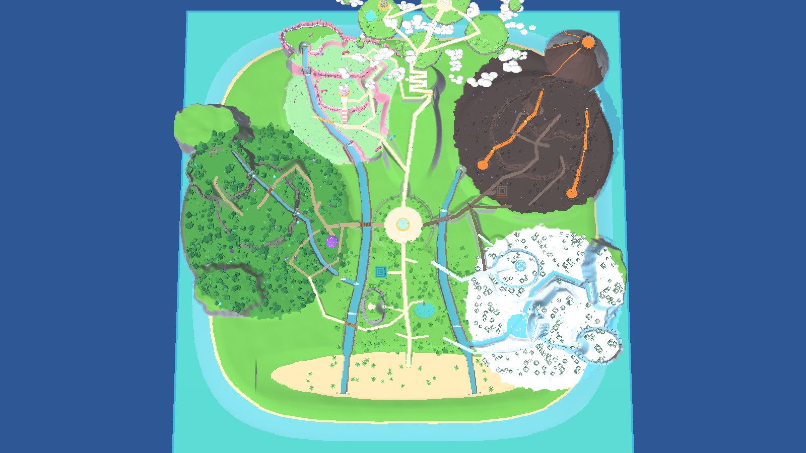

# Egg World map (Roblox)

A procedural, repeatable builder for the creature-battling / egg-hatching world shown in the
three concept images: central egg pavilion, starter meadow, jungle, candy cliffs, volcano, snow
and crystal valley, and golden sky islands. This build covers the environment only: terrain,
scenery, traversal, lighting and gameplay markers.



> The images in `docs/previews` are **offline preview renders** made by `tools/render.py` from the
> headless build: flat shading, no shadows, no Roblox materials. They are not Studio screenshots.
> They show layout, silhouettes and colours, not final visual quality.

## Building it in Studio

1. Sync the project into a place, either with [Rojo](https://rojo.space) (`rojo serve` in this folder, then
   connect from the Studio plugin) or with `rojo build -o EggWorld.rbxlx` and open the file.
   The project puts:
   - `ServerStorage.WorldBuilder` (the builder ModuleScript and its modules)
   - `ReplicatedStorage.WorldShared` (biome zones, lighting moods and reference cameras, used by the client)
   - `ServerScriptService.WorldBootstrap`
   - `StarterPlayerScripts.EnvironmentController` and `StarterPlayerScripts.ShowcaseCamera`
2. In **Edit** mode, run this in the command bar:
   ```lua
   require(game.ServerStorage.WorldBuilder).Build()
   ```
   The builder writes terrain, builds `Workspace.WorldMap`, configures Lighting and streaming, builds a
   reusable `ServerStorage.WorldAssetLibrary`, then runs the route audit and prints its report.
3. Check the Output window, then **save the place**. The map is meant to ship saved; the bootstrap
   script only builds at runtime if `Workspace` has the attribute `AutoBuildWorld = true`.

Re-running `Build()` is safe:
- It replaces `Workspace.WorldMap`, the terrain inside the 3,600 × 3,600 world volume, the Lighting
  effects it created (named `World*`) and `ServerStorage.WorldAssetLibrary`.
- It touches nothing else.

Other helpers:
```lua
local WB = require(game.ServerStorage.WorldBuilder)
WB.Audit()               -- walk every route again with raycasts and print problems
WB.Camera("Overview")    -- move the Studio camera to a reference view (also: StarterMeadow, Jungle,
                         -- CandyCliffs, Volcano, SnowValley, SkyIslands)
```
Before saving, also enable these settings by hand:
- `Lighting.LightingStyle = Realistic` and `PrioritizeLightingQuality` (in the Properties window).
- Instance streaming (`Workspace.StreamingEnabled`).

The builder sets all three when the engine allows it, and prints a warning for any it could not set.

## Layout and actual scale

All measurements are studs. +X is east and -Z is north, so the overview image looks north from the south.

| Region | Built footprint (terrain, incl. scenery edges) | Walkable heights | Target in brief |
|---|---|---|---|
| Hub + starter meadow (+ beach) | ≈ 1,000 × 1,350 (hub plaza 300 across) | Y 100–140 | 950 × 1,000, Y 100–180 |
| Jungle | ≈ 1,260 × 1,460 (walk network ≈ 1,000 × 1,200) | Y 126–300 (scenery to 330) | 1,000 × 1,100, Y 120–320 |
| Candy cliffs | ≈ 940 × 960 | Y 152–290 (cliffs to 330) | 900 × 900, Y 140–330 |
| Snow & crystal valley | ≈ 1,080 × 1,040 | Y 104–205 (hills to 280) | 1,000 × 1,000, Y 80–280 |
| Volcano | ≈ 1,200 × 1,250 + cone | Y 142–310 (cone peak 545) | 1,200 × 1,100, Y 120–400 |
| Sky islands | ≈ 1,250 × 760 | Y 292 (gate) → 400–480 islands; temple to ≈ 660 | 900 × 1,000, Y 380–700 |

- **World and paths:** the world is 3,600 × 3,600 with a sea margin and invisible boundary walls. Main paths are 30–34 wide, secondary paths 18–24, and every bridge is at least 24 wide.
- **Grades:** the steepest walking ramp is 18.2° (the temple bridge) and the steepest stairs are 30.2° (the temple stairway).
- **Activity spaces:** creature clearings are 120–170 across, boss arenas 180–210, and hatch pavilions 80–104 wide.
- **Eggs and trees:** large eggs are 20–26 tall and small eggs 8–8.5. Trees are 38–82 tall, with jungle landmark trees at 96–130.

All coordinates, terraces, rivers, paths and landmark sites live in
[`src/WorldBuilder/Layout.luau`](src/WorldBuilder/Layout.luau). Change the world there.

### How regions connect

**Hub:** the central egg pavilion sits on a 300-stud paved plaza. Four spokes leave it, each with a signpost.

**Starter meadow (south):**
- The teal timber hatch pavilion and the first creature clearing are ≈ 250 studs from spawn.
- The pond has a dock and lily pads.
- A walkable cave is cut into a cliff ridge.
- Three creature fields, with a palm beach in the foreground.

**Jungle (west, over the west river):**
- Ruin-arch gateway and the purple mushroom hatch pavilion.
- Lower stepping-stone river loop.
- Hillside climb to the mid terrace and its bridge.
- Climb to the guardian ruin arena on the upper terrace.
- South link back to the meadow, so you can do a loop.

**Candy (north-west):**
- Donut-flanked entrance and a wafer bridge.
- Grand stairs plus a separate east ramp up to the striped pavilion terrace.
- Climb to the donut arena on the high cliffs.
- Link from there to the sky gate.

**Volcano (east/north-east, over the east river):**
- Ember gate, molten pavilion, and a climb through two terraces to the crater arena.
- Arched bridge over the lava to a crystal cave.
- Lower loop.
- Link to the snow valley.

**Snow (south-east):**
- Ice gate and frost hatch station.
- Valley clearing and frozen lake.
- Climb to the glacier arena and ice cave.
- Cliff stairs back down.
- Lake loop that returns to the meadow.

**Sky:**
- The northern ridge path leads to the sky gate and the five-flight celestial stair.
- From there you reach the gate isle, which links by bridges to the pool isle (golden pavilion), the temple isle (temple stairway and bridges) and the garden isle (arena).
- These form a loop.

Every region has a main entrance, a return route and at least one alternate route. Nothing is locked.

## What is in the place

```
Workspace.WorldMap
  Hub / StarterMeadow / Jungle / CandyCliffs / Volcano / SnowValley / SkyIslands
      Landmarks, Vegetation, Props, Creatures, Cliffs, Bridges, Stairs, Caves, Waterways, PathDressing, Ambience ...
  GameplayMarkers
      CreatureSpawn (18)  BossArena (5)  HatchStation (8)  BiomeEntrance (6)  Hazards (11 lava volumes)
  Boundaries
  WorldSpawn (SpawnLocation)
```

- **Markers:** markers are invisible, non-colliding and tagged with CollectionService (`CreatureSpawn`, `BossArena`,
  `HatchStation`, `BiomeEntrance`). Each carries `Biome` and `Radius` attributes.
- **Lava:** lava is visual only. It is Neon surface parts (`Decorative` attribute) with basalt curbs as boundaries. Inert `LavaHazardVolume` parts mark where a future damage system can hook in, and nothing in this build deals damage.
- **Creatures:** creatures are anchored display placeholders with a `Species` attribute. That covers the original "brainrot" ones (Toastodile, Sir Wobbleton, Bananarang, Capyccino) plus monkeys, frogs, gummy bears, cupcakes, lava pups, golems, penguins, foxes, a yeti, cloud sprites and the jungle guardian statue.
- **Collision:**
  - Walkable bridge decks, landings and stairs use one smooth invisible collider each. Planks and steps are non-colliding decor on top, so feet never snag on seams.
  - Railings, parapets, fences, trunks and rocks collide.
  - Foliage, flowers, vines and small ornaments do not, and canopies also ignore camera queries.

## Lighting and moods

- `LightingSetup` applies the default mood:
  - Brightness 2.25, exposure +0.1, ShadowSoftness 0.7, diffuse/specular scale 0.8/0.35.
  - Cool ambient, outdoor ambient brighter neutral-cool.
  - Atmosphere density 0.2, bloom 0.2, a modest colour correction and subtle sun rays.
  - Dynamic clouds.
- `EnvironmentController` (client) blends Lighting, Atmosphere, Bloom, ColorCorrection and SunRays towards each biome's mood over 4 seconds:
  - Jungle: purple dusk with a lit floor.
  - Candy: pastel.
  - Volcano: warm haze.
  - Snow: cool.
  - Sky: clear with gold.
- How the controller behaves:
  - Zones are plain data in `ReplicatedStorage.WorldShared.BiomeZones`, so streaming never breaks it.
  - Overlapping zones resolve by priority, then by nearest centre.
  - Respawns snap to the correct mood.
  - Everything runs client-side, so each player sees only their own biome's mood.
- `ShowcaseCamera`: set the Workspace attribute `ShowcaseCamera` to a reference view name during a play test to frame it with light depth of field. Normal gameplay never uses blur or depth of field.

## Streaming and performance

- Streaming settings:
  - `StreamingEnabled` on, min radius 256, target radius 1,024.
  - Opportunistic stream-out, `PauseOutsideLoadedArea` integrity.
- Model streaming modes:
  - Pavilions, bridges, stairs, caves and gates are `Atomic` models.
  - The volcano cone dressing is `Persistent`.
  - Landmark models use `LevelOfDetail = StreamingMesh`, so distant silhouettes survive stream-out.
- Headless build totals: **27,068 parts** (48 of them invisible walk colliders), **290 light sources**, **61 particle emitters** and **15 bridges** (including 2 stepping-stone crossings). Terrain is 361 chunk writes covering ≈ 24.7 M voxels.
- Per region: Jungle 7,702, Meadow 4,791, Sky 3,975, Snow 3,505, Candy 3,425, Volcano 2,215, Hub 1,191.
- Lights are spaced so they rarely overlap: every second path lantern has a light, and so does every third big glowing mushroom.

**FPS has not been measured.** No device testing was possible in this environment (see below).

## Testing record

### Done (headless, in this repository's tooling)

`tools/` contains a strict Roblox engine mock. Unknown classes, properties and enum items raise errors, as does any part larger than 2,048 studs. It also contains a bundler and a Luau CLI runner that execute the **real builder code** end to end.

- Every module compiles with the Luau compiler.
- A full build completes. Terrain voxel channels are validated: sizes, the 4-stud grid alignment and occupancy ranges.
- These real bugs were caught and fixed this way:
  - An ambiguous-syntax statement in the mushroom builder, which would not compile in Studio.
  - A 3,560-stud boundary wall over the part size limit.
  - Steps at path junctions and bends.
  - A lip where each celestial-stair flight met its landing.
  - Gateway pillars and cave frames intruding into paths.
  - A sky-gate approach running under the first flight.
- The **route audit** (`Audit.luau`) raycasts every main path, alternate route, bridge, stairway, cave and sky walkway every 4 studs, at the centre and at both edges. Here it runs against the builder's own height field plus oriented part boxes. Results from the final build:
  - 5,093 samples. **0 holes, 0 bumps, 0 obstructions at knee/chest height, 0 low ceilings, 0 over-steep design grades, 0 unanchored parts.** The spawn has ground.
  - 1 remaining note: an under-1-stud lip where the temple bridge meets the temple island rim.
  - 4 "bend blend" samples on one candy switchback, where the inside corner differs from the design height by 2.5–2.9 studs. Terrain there is continuous, not a step.
  - All 15 bridge decks clear the water they cross. The lowest are the jungle stepping stones, 1.5 above water, by design.
- Preview renders were made from all seven reference camera positions plus a top-down map, with side-by-side comparisons against the three reference images in `docs/previews/compare_*.jpg`.

To rerun it, get the Luau CLI from the luau-lang/luau releases page, then:
```
node tools/bundle.js tools/out/bundle.luau        # bundle mock + sources + tools/run_build.luau
luau tools/out/bundle.luau                         # build + audit (≈ 25 s)
# previews: prepend `__EXPORT = true` to the run script, save the output, then
python3 tools/render.py export.txt out_dir [reference_image_dir]
```

### Still needed in Studio (not possible here)

The headless audit uses an idealised terrain surface. Roblox smooth terrain is voxelised at 4 studs, so these must be confirmed in Studio:

1. Run `Build()`, check Output, then run `Audit()` against real terrain collision.
2. Walk every route with **R6 and R15** rigs at several avatar scales, including bridges, stairs, cave mouths, the celestial stair and the island bridges. Watch for snagging, sliding and camera obstruction.
3. Test spawn, reset and repeated respawns, and the 4-second mood blends. Then run **2+ players** (Test → Clients and Servers) in different biomes.
4. Test streaming by travelling repeatedly between distant regions, such as the hub → sky temple → snow cave.
5. Check graphics levels low, medium and high. Path readability comes from ground colour and material contrast, not lighting.
6. Measure FPS and memory at the central pavilion, the jungle mushroom pavilion and the overview camera, on a midrange desktop and on mobile. Then tune effect and light densities.
7. Capture Studio screenshots from `WB.Camera(...)` views and compare them with the concept images.

### Known limitations and deviations

- **Assets:** no uploaded meshes or audio. Everything is built from Parts, SpecialMesh spheres and terrain. Curved forms are faceted, which suits the low-poly style but is less smooth than custom meshes.
- **Ambience:** ambient water, wind, jungle and volcano audio is **not included**, because no verified sound asset IDs were available. Particles use only built-in `rbxasset://` textures.
- **Scale vs. the overview:** the overview image shows a compact diorama, while the brief asks for ≈ 3,600 studs. The arrangement, connections and landmark order match, but at this scale the regions sit further apart and open fields are larger than in the painting.
- **Waterfalls:** they are animated with particles at the base. The sheets themselves are static.
- **Rivers:** they step down at waterfalls rather than flowing on a slope, which is a terrain water limitation.
